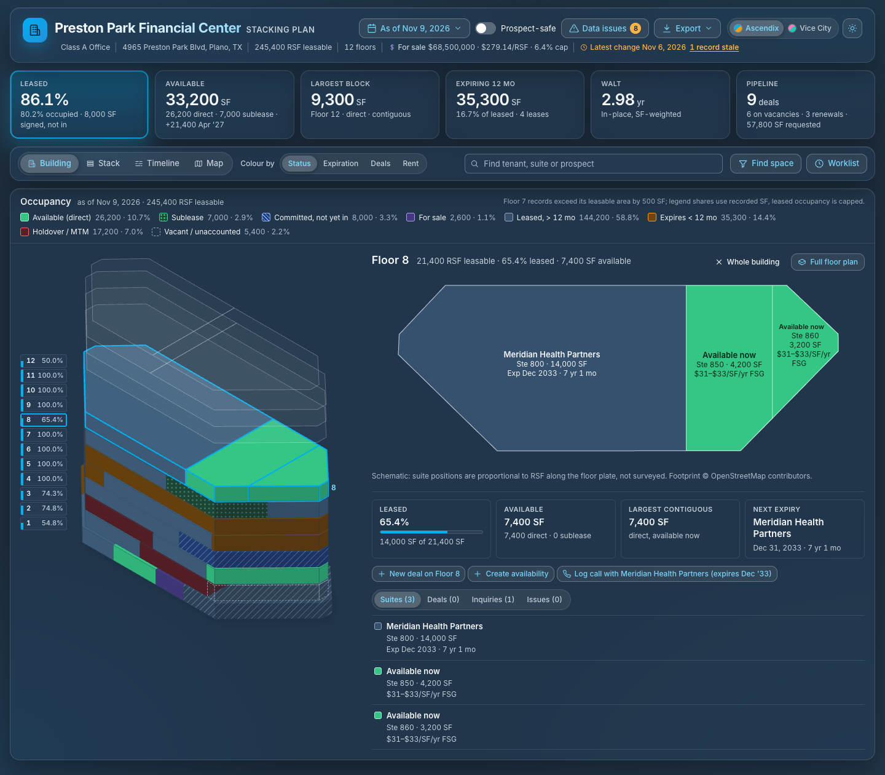
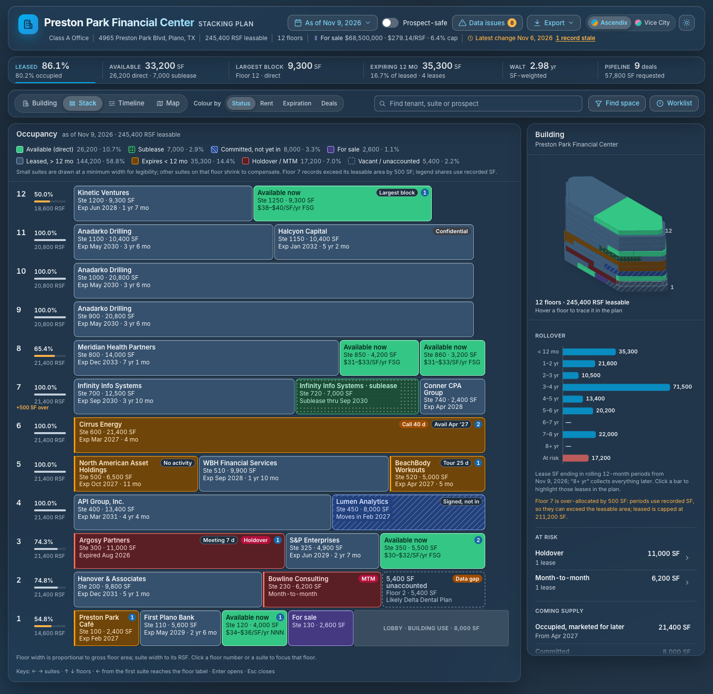
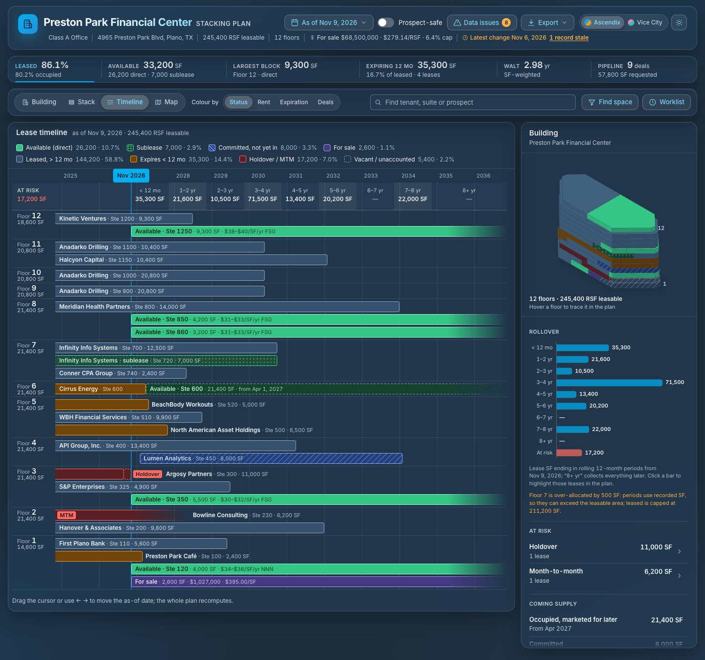
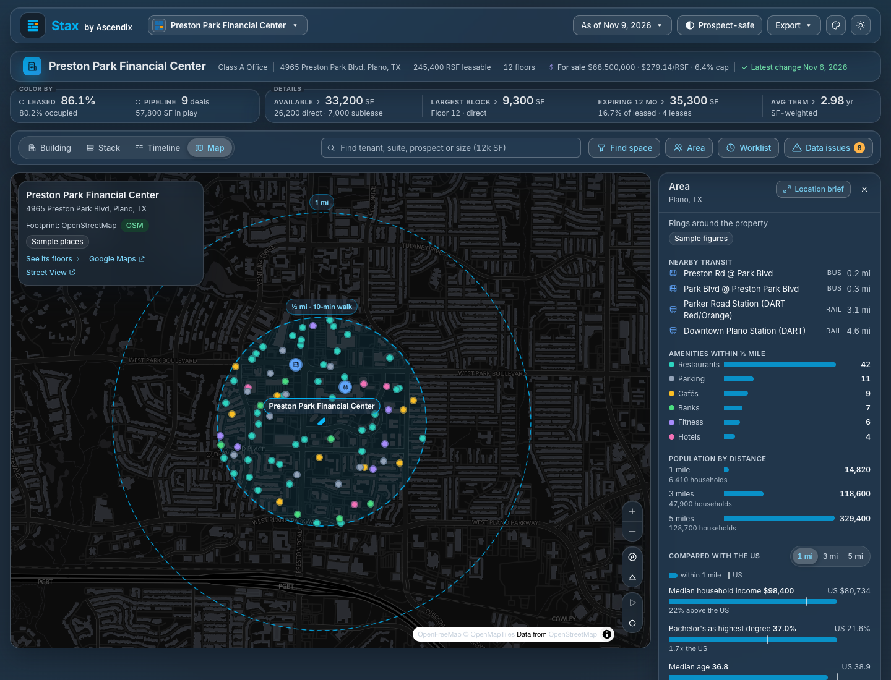
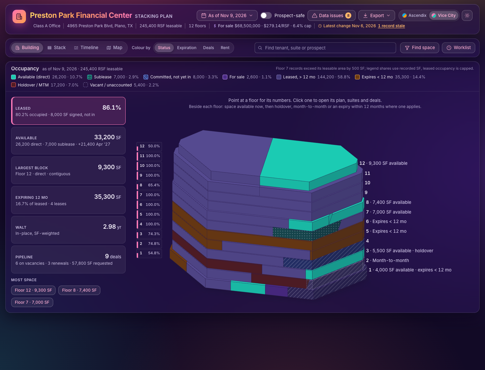
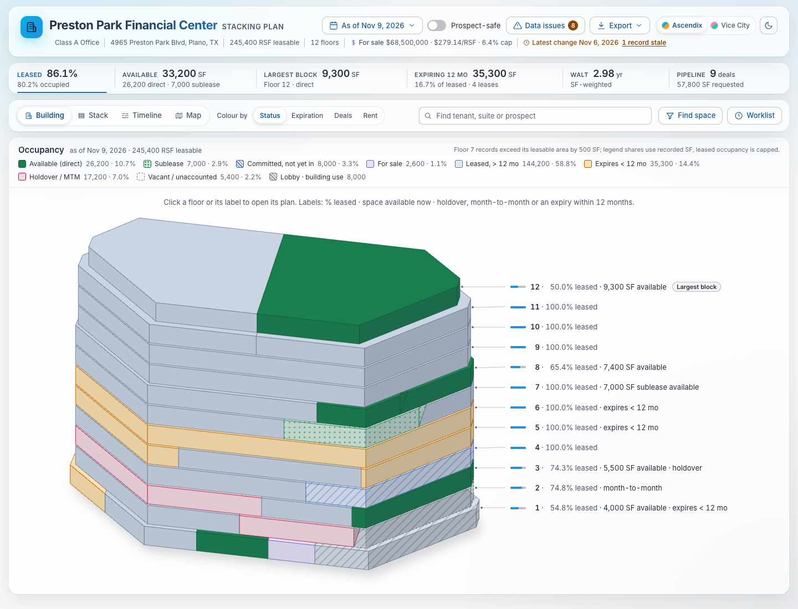

# Stax by Ascendix

Stax is an interactive stacking plan that lets a broker see a building's availability, expirations and leasing options in one screen, and share a safe version of it with a prospect.

Built for the Ascendix Tech Challenge, November 2026. It is a prototype on mock data, not a production application.



## The problem

A stacking plan draws a building floor by floor, with each suite as wide as its square footage. Brokers use it to answer a handful of questions, and today most of those answers take a spreadsheet, a rent roll and several clicks:

- **Where is the space?** How much is vacant, on which floors, and what is the largest contiguous block?
- **What is coming?** Who expires in the next 12 to 24 months, and what is already committed but not yet moved in?
- **Does a requirement fit?** Is there 12,000 SF available by a given date, direct or sublease?
- **Can I trust it?** Is space double-counted, is a lease missing its floor, is a record stale?
- **Can I show it?** A prospect or buyer should see the availability without seeing who the other tenants are or what they pay.

A typical stacking plan is a picture of the building: one color scheme, several lines of text in every block, no analytics, no way to look ahead in time, and no version that is safe to hand to someone outside the brokerage.

## The solution

One model of the building, shown four ways, with the answers to the questions above one click away.

| Stack | Timeline | Map |
|---|---|---|
|  |  |  |

**For the broker**

- **Building view.** The landing screen: a large model of the building cut into suites and colored by the lens, with one label beside each floor (percent leased, space available, what is expiring) that is also the way to open it. Click a floor and the model turns, shrinks and docks to the left while that floor's plan comes in beside it, with the floor's numbers, suites, deals, inquiries and issues below. "Whole building" brings the model back.
- **Six KPIs, always on top.** One quiet bar above every view: leased %, available SF, largest block, expiring in 12 months, WALT and pipeline. Each is a shortcut, and pointing at "Largest block" lights that block on the plan.
- **Stack view.** The classic plan with an inspector beside it. Clicking a floor or suite expands it with the detail from every lens.
- **Four color lenses.** Status, expiration, deal stage and rent. Every state also has a pattern or label, so color is never the only cue.
- **Time travel.** Move the as-of date and the plan, KPIs and rollover chart recompute. Future vacancies and signed-but-not-commenced leases are drawn as what they are.
- **Space finder.** Enter a size, a date and direct or sublease; matching blocks light up, including pairs of adjacent floors and near misses. An open inquiry can be matched to space the same way.
- **Renewal worklist.** Leases at risk or expiring within 90 days, 180 days, 12 or 24 months, with the last touch on each.
- **Data issues.** Over-allocated floors, unaccounted area, leases without a floor, holdover and month-to-month leases and stale deals are listed and marked on the plan.
- **Timeline and map.** Every lease as a bar against time; the building in its surroundings on a real map, with transit, amenities and the walking ring, and its height among its neighbours in 3D.
- **The area around the building.** Demographics, amenities and transit as charts from the Area button in every view, compared with the US. One toggle widens the panel to the location brief, a full-width page to show a client or decision maker, which also closes the PDF report.

**For the prospect, tenant or buyer**

- **Prospect-safe mode.** One switch hides tenant names, contacts, in-place rents and the deal pipeline everywhere, including exports. Asking rents stay visible because they are marketing information. An automated check confirms nothing leaks.
- **Something to send.** A print-ready PDF report, a PNG of the plan for a slide, a CSV rent roll, and a link that reopens the exact view.
- **Space for sale.** For-sale units appear on the plan as their own state, and a building sale listing shows as a banner.
- **Present mode.** The 3D building orbits while the as-of date advances, and can be recorded as a video.

It works with a keyboard and a screen reader, and on a phone. It opens in the Ascendix colors (Primary Blue and Primary Orange on the company navies, dark by default, with a daytime version behind the theme switch). The challenge's Vice City theme, neon on deep purple, is the second palette: the header's palette control or `?palette=vice` selects it.





## Tools used

**AI**

- **Claude Code** with Claude Fable 5.1 and 5.2 and Claude Opus 5.5 wrote the design specification, the code and the tests, working from a written brief.
- **An AI review council.** After each build, independent AI reviewers scored screenshots and the running app against a fixed UI and UX rubric, and the fixes at least two of them agreed on went into the next round. Rounds 0 to 10 used three reviewers (two Claude Opus 5.5 sessions and Grok 4.7); round 10 averaged 37 out of 40. From round 11 a fourth reviewer, GPT-6.1 Sol, joined. Round 11 was the first to score the Vice City colors and the Building view and averaged about 86 out of 100 (UI, UX and engineering). Round 12 averaged 90.5 and round 13 averaged 93.5, with every reviewer at 90 or above. Round 14, the first in the Ascendix colors, averaged 93.75, round 15 averaged 93.75 and round 16 averaged 93.25. Round 17 averaged 95.25 (Grok 97, GPT-6.1 Sol 96, Opus A 95, Opus B 93), the first round to reach the 95 target with every reviewer above 90. Round 18, the first to score the Area panel and the location brief, averaged 91.5 (Grok 94, GPT-6.1 Sol 93, Opus A 93, Opus B 86). Round 19, the first to score the agreed header buttons and the ten-building switcher, averaged 90.75 (GPT-6.1 Sol 92, Grok 92, Opus A 91, Opus B 88); all four reviewers asked for Data issues to be reachable again and for legend shares rounded one by one. Round 20 ran with three reviewers and scored the build before the UX-clarity pass (PR #22): GPT-6.1 Sol 93 and Grok 95; the Opus review hit an API rate limit and has no score. Round 21, the first after the UX-clarity pass and the first scored against the challenge rules' Best UX personas, ran with three reviewers and averaged 92.7 (Grok 94, GPT-6.1 Sol 93, Opus 91). Round 22, the first with keyboard-reachable legend figures, a labelled Location brief button and a one-line building card, was back to four reviewers and averaged 92 (Grok 95, GPT-6.1 Sol 93, Opus B 91, Opus A 89); the reviewers marked down the new legend's own defects: an ⓘ note drawn under the map, clipped tooltips, no note on the phone Timeline, and a prospect-safe Rent "Leased" figure that counts unrecorded space. Round 23, the first with four buildings that open and a search box that sends a size to Find space, averaged 92.25 (Opus B 94, Grok 94, GPT-6.1 Sol 92, Opus A 89); all four reviewers asked for the date to be read anywhere in a search, for one name for space with no lease or listing, and for the PDF's Pipeline card to say "in play" as the screen does, and three for Cedar Springs to show that it is under contract. Round 24, the first with the Map redesigned around the building's surroundings, was scored by two reviewers and averaged 92.5 (Grok 95, GPT-6.1 Sol 90). Both asked for the Map's interactions to be finished: a search answered on the Map, a stop outside the frame brought into view, the phone map's labels clear of its links. The reports are in `docs/judging/`.
- **AI-assisted research** for the competitor analysis in `docs/COMPETITORS.md`, from public vendor pages, help centers and review sites.

**Application**

- React 19, TypeScript and Vite
- MapLibre GL with OpenFreeMap tiles for the map
- Plain CSS on design tokens, with no UI framework

**Quality**

- Vitest for unit tests of the domain logic
- Playwright for screenshots, PDFs and smoke checks
- axe-core for accessibility checks
- oxlint for linting

**Public data**

- OpenStreetMap, through the Overpass API, for the building footprint and nearby amenities
- US Census Bureau ACS 5-year data for demographics (live mode only), and the national ACS 5-year 2020–2024 figures the area is compared with (fixed in `src/domain/areaBrief.ts`)

## Assumptions

**Data**

- All leases, tenants, contacts, rents, deals, inquiries and the sale listing are mock data written for this prototype. No company, customer or personal data is used.
- The building name, address and footprint are a real, public location in Plano, Texas, used only to place the model on the map. The footprint comes from OpenStreetMap. Nothing shown reflects the real building's tenants, floors or pricing.
- The mock data is shaped like the AscendixRE objects (Property, Floor, Lease, Unit, Availability, Deal, Inquiry), so the same screens can later read real records.
- The mock building contains each awkward case at least once: holdover, month-to-month, a committed future lease, occupied-but-marketed space, a sublease, an over-allocated floor, a multi-floor tenant, a confidential lease, records with no floor, and a for-sale unit.
- "Today" is fixed at November 9, 2026, so screenshots are reproducible.
- Three more buildings open from the header's switcher: Legacy West Tower II, Cedar Springs Exchange and Bluebonnet Office Park. Their names, records and footprints are fictional sample data. The switcher's other entries are samples with no data behind them and do not open.
- Demographics are sample figures unless live mode is on. Floor plates are schematic, derived from the footprint, and are not real floor plans.

**Domain**

- Areas are rentable square feet. Rents are always shown with their unit and lease type, for example $/SF/yr FSG.
- Availability is not vacancy: a space can be occupied and marketed for a later date.
- A lease past its expiration with no termination date is a holdover; a lease with no expiration date is month-to-month.
- Confidential leases never show their rent.
- Nothing is shown that AscendixRE does not store, such as lease options or notice dates.

**Scope**

- Four buildings, one at a time. No sign-in and no saving of changes.
- Record actions (open record, new deal, log call, start renewal) show a message describing what they would do in the CRM.
- Built and checked in desktop Chrome. Video recording needs Chrome or Edge.

## Development plan

How this prototype could become a product feature is described in [`docs/PLAN.md`](docs/PLAN.md): the feature inventory by priority, the Salesforce architecture (Lightning Web Components and Apex), the data mapping to AscendixRE objects, external services, phases with estimates, and risks. Running it as a hosted app inside an iframe on the Property page instead, with its architecture, sign-in and monthly running cost, is described in [`docs/INFRASTRUCTURE.md`](docs/INFRASTRUCTURE.md).

## Run it

Requires Node `^20.19.0` or `>=22.12.0`.

```bash
npm install
npm run dev        # http://localhost:5173
```

| Command | What it does |
|---|---|
| `npm run dev` | Dev server with hot reload |
| `npm test` | Unit tests |
| `npm run lint` | Lint |
| `npm run build` | Type-check and build to `dist/` |
| `npm run preview` | Serve the `dist-judge/` build on http://localhost:4180 |

`npm run preview` does not serve `dist/`. Build into the folder it serves first:

```bash
npx vite build --outDir dist-judge
npm run preview
```

On an older Node version `npm install` silently skips the native binaries for the linter and bundler, and `npm run lint` fails with "Cannot find native binding".

### Browser checks

These drive the preview build with Playwright. They need Google Chrome installed and the preview running on port 4180; set `BASE` to use another URL.

| Command | What it checks or produces |
|---|---|
| `npm run verify` | Smoke checks: structure, keyboard navigation, time travel, no console errors |
| `npm run a11y` | Accessibility; fails on serious or critical violations |
| `npm run leakcheck` | No tenant, contact or prospect name and no in-place rent in prospect-safe mode |
| `npm run shots -- <outDir>` | A PNG of every reviewed state |
| `npm run pdf -- <outDir>` | PDFs of the print layout |

### Jump to any view

All state lives in the URL, so every view can be linked to.

| Parameter | Values | Meaning |
|---|---|---|
| `building` | property id: `P002`, `P005`, `P007` | Which building is open (default: Preston Park Financial Center, `P001`) |
| `view` | `building`, `stack`, `timeline`, `map`, `floor` | Which view is shown (default `building`; on a phone the stack stands in for it) |
| `lens` | `status`, `expiry`, `deals`, `rent` | What the colors encode |
| `asOf` | `YYYY-MM-DD` | As-of date |
| `select` | block id, e.g. `L13-U1`, `A02` | Selected suite or availability |
| `floor` | floor id, e.g. `F6` | Pinned or focused floor |
| `safe` | `1` | Prospect-safe mode |
| `req`, `max` | SF | Space finder: minimum and maximum size |
| `by` | `YYYY-MM-DD` | Space finder: needed-by date |
| `fit` | `any`, `direct`, `sublease` | Space finder: availability type |
| `inquiry` | inquiry id, e.g. `I02` | Match an inquiry to space |
| `window` | `risk`, `90`, `180`, `12`, `24` | Renewal worklist window |
| `bucket` | `0`, `1`, … | Highlight one 12-month rollover period |
| `q` | text | Search tenant, suite or prospect |
| `mode` | `issues`, `area`, `brief`, … | Inspector panel, when not implied by the above (`brief`: the Area panel widened to the location brief) |
| `theme` | `light`, `dark` | Theme (default `dark`) |
| `palette` | `vice` | The Vice City palette instead of the default Ascendix colors |
| `skin` | `aurora`, `classic` | The original blue glass, or the flat Salesforce Lightning look, instead of either palette |
| `print` | `1` | Print layout |
| `live` | `1` | Fetch footprint and area data live |
| `census` | API key | US Census API key for live demographics |

Examples: `/?floor=F8` pins floor 8; `/?req=12000` finds 12,000 SF; `/?safe=1` is the prospect-safe plan; `/?view=stack` is the classic stacking plan; `/?view=map` is the map of the surroundings, with the Area panel beside it.

### Project layout

```
src/
  domain/       Pure TypeScript, no React, unit-tested: derivation, lenses, rollover,
                space finder, data issues, timeline, geometry, CSV export
  state/        URL-synced plan state
  model/        Derives everything the views render from the property and the state
  data/         Mock building, and the OpenStreetMap and Census sources
  components/   Building, stack, timeline, map, floor, inspector, KPIs, print, UI primitives
  styles/       Design tokens, base styles, skins, print
scripts/        Playwright checks and screenshot/PDF generators
docs/           Brief, design spec, development plan, competitor analysis, review rounds
```

### More documentation

| File | Contents |
|---|---|
| [`docs/BRIEF.md`](docs/BRIEF.md) | Personas, their top jobs, domain rules, the review rubric |
| [`docs/DESIGN.md`](docs/DESIGN.md) | Screen-by-screen design specification |
| [`docs/PLAN.md`](docs/PLAN.md) | Feature inventory, numbered requirements and development plan |
| [`docs/ARCHITECTURE.md`](docs/ARCHITECTURE.md) | How the code in `src/` is built: layers, state, prospect-safe policy |
| [`docs/INFRASTRUCTURE.md`](docs/INFRASTRUCTURE.md) | Iframe deployment: architecture, sign-in, running cost |
| [`docs/COMPETITORS.md`](docs/COMPETITORS.md) | Competitor analysis |
| `docs/judging/` | AI reviewer reports for each round |
| `docs/shots/` | Screenshots of every reviewed state for each round |
