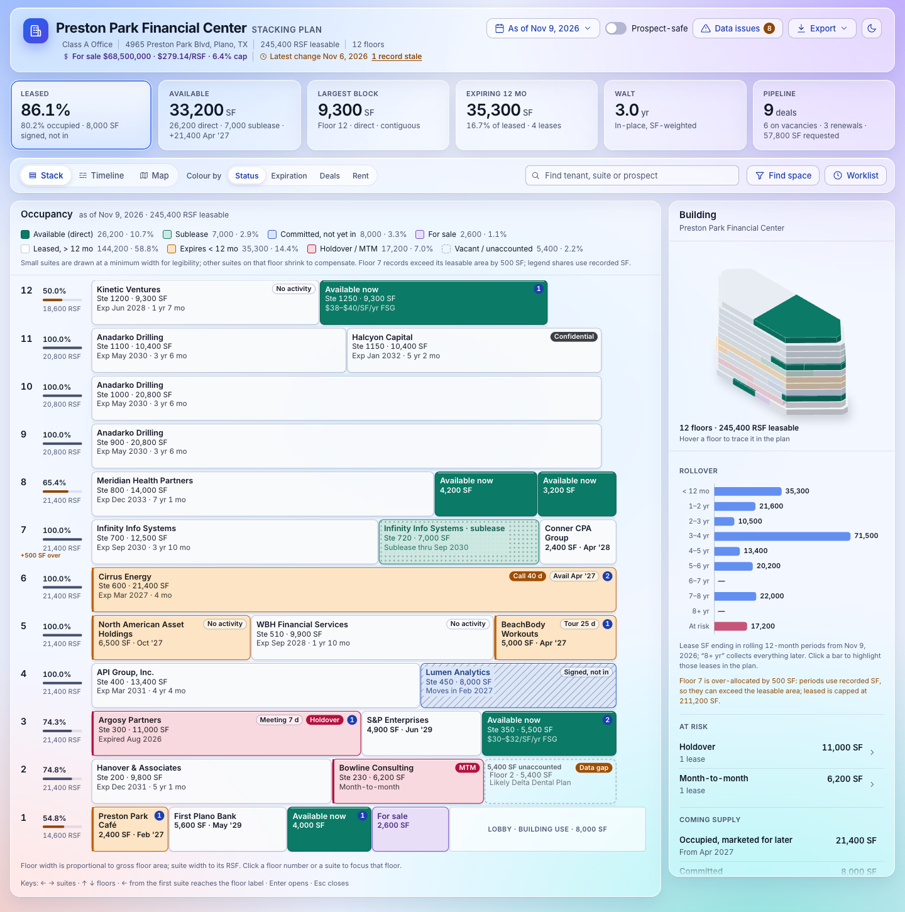
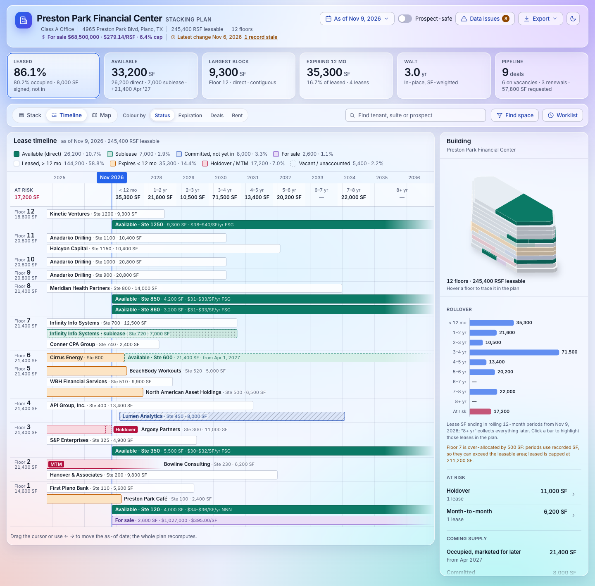
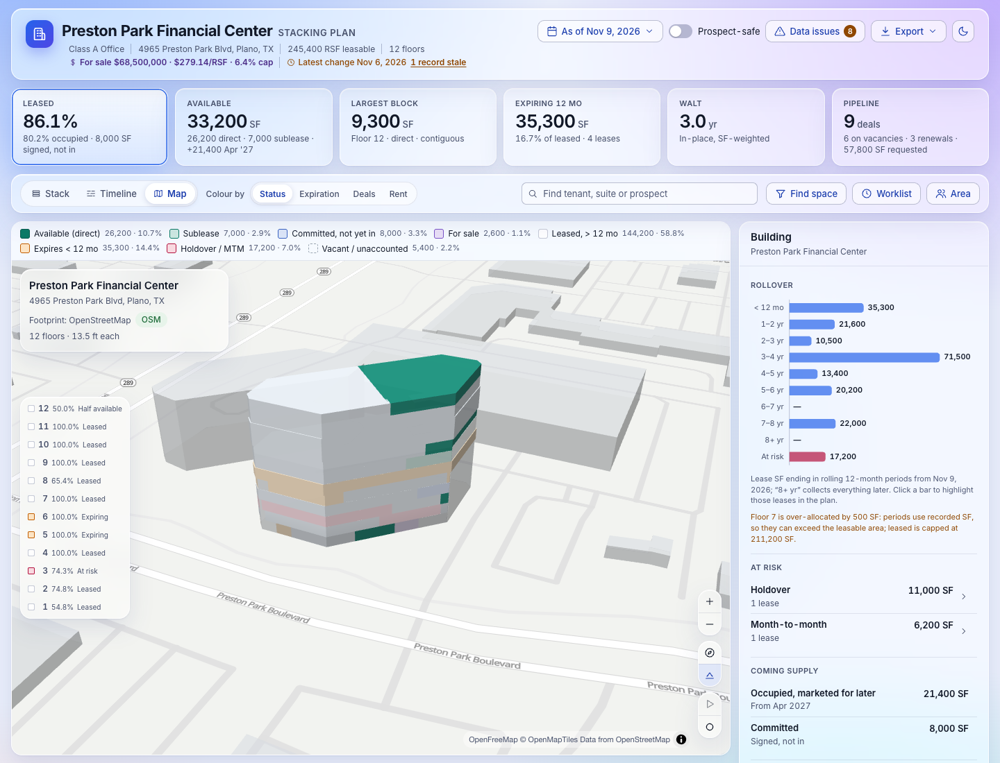
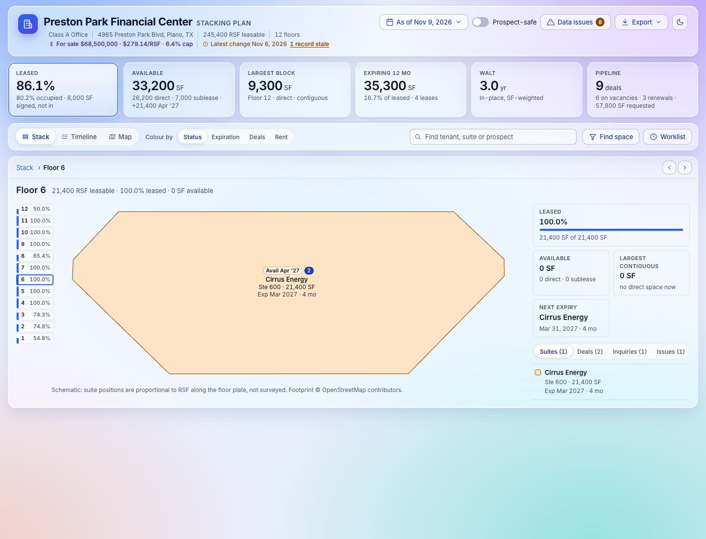

# Stacking Plan v2

A from-scratch rebuild of the AscendixRE Stacking Plan as a standalone web app. A stacking plan draws a building floor by floor, with each suite's width proportional to its square footage, so a leasing team can see at a glance what is leased, what is available, who expires when, and where the data is wrong.

This repository is a prototype: React, TypeScript and Vite, running on mock data for one building (Preston Park Financial Center, 12 floors). There is no backend, no authentication and no persistence.



| Timeline | 3D map | Floor plate |
|---|---|---|
|  |  |  |

## What it does

- **Four views of one model.** Stack (the 2D plan), lease timeline, 3D building on an OpenStreetMap basemap, and a floor-plate drill-in.
- **Four colour lenses.** Status, expiration (months from the as-of date), deal stage, and rent.
- **Time travel.** Move the as-of date and the plan, KPIs and rollover chart recompute; projected vacancies and committed leases are drawn as such.
- **Space finder.** Search for contiguous blocks by size, date and direct/sublease, or match an open inquiry to space.
- **Renewal worklist.** Leases at risk or expiring within 90 days, 180 days, 12 or 24 months.
- **Data issues.** Leases without a floor, over-allocated floors, unaccounted area, holdover and month-to-month leases, stale deals.
- **Prospect-safe mode.** Hides tenant names, contacts and in-place rents on screen and in every export.
- **Exports.** Print/PDF report, PNG of the plan, CSV rent roll, and a copyable link to the exact state.
- **Accessibility and layout.** Keyboard grid navigation, screen-reader names, light and dark themes, phone layout.

Record actions (open record, new deal, log call and so on) are stubs: they show a toast describing the Salesforce action they would take.

## Getting started

Requires Node `^20.19.0` or `>=22.12.0`. On older Node versions `npm install` silently skips the native binaries for the linter and bundler, and `npm run lint` fails with "Cannot find native binding".

```bash
npm install
npm run dev        # dev server on http://localhost:5173
```

| Command | What it does |
|---|---|
| `npm run dev` | Vite dev server with hot reload |
| `npm test` | Unit tests (Vitest) |
| `npm run lint` | Lint with oxlint |
| `npm run build` | Type-check and build to `dist/` |
| `npm run preview` | Serve the `dist-judge/` build on http://localhost:4180 |
| `npm run preview:next` | Serve the `dist-next/` build on http://localhost:4181 |

`npm run preview` does not serve `dist/`. Build into the folder it serves first:

```bash
npx vite build --outDir dist-judge
npm run preview
```

`dist-next` works the same way and exists so a candidate build can run next to the current one.

## Browser checks

These scripts drive the preview build with Playwright. They need Google Chrome installed and the preview running on port 4180; set `BASE` to point them at another URL.

| Command | What it checks or produces |
|---|---|
| `npm run verify` | Smoke checks: structure, keyboard grid, time travel, no console errors |
| `npm run a11y` | axe-core on the main views; fails on serious or critical violations |
| `npm run leakcheck` | No tenant, contact or prospect name and no in-place rent anywhere in prospect-safe mode |
| `npm run shots -- <outDir>` | PNG of every reviewed state (default `docs/shots/latest`) |
| `npm run pdf -- <outDir>` | PDFs of the print layout (default `docs/shots/latest/pdf`) |

`node scripts/one.mjs "<query>" out.png [width] [height] [dark]` takes a single screenshot of any state.

## URL parameters

All state lives in the query string, so any view can be linked to or scripted. Defaults are omitted from the URL.

| Parameter | Values | Meaning |
|---|---|---|
| `view` | `stack`, `timeline`, `map`, `floor` | Which view is shown (default `stack`) |
| `lens` | `status`, `expiry`, `deals`, `rent` | What the colours encode (default `status`) |
| `asOf` | `YYYY-MM-DD` | As-of date (default: today) |
| `select` | block id, e.g. `L13-U1`, `A02` | Selected suite or availability |
| `floor` | floor id, e.g. `F6` | Focused floor |
| `safe` | `1` | Prospect-safe mode |
| `req`, `max` | SF | Space finder: minimum and maximum size |
| `by` | `YYYY-MM-DD` | Space finder: needed-by date |
| `fit` | `any`, `direct`, `sublease` | Space finder: availability type |
| `inquiry` | inquiry id, e.g. `I02` | Match an inquiry to space |
| `window` | `risk`, `90`, `180`, `12`, `24` | Renewal worklist window |
| `bucket` | `0`, `1`, … | Highlight one 12-month rollover bucket |
| `q` | text | Search tenant, suite or prospect |
| `mode` | `building`, `block`, `floor`, `find`, `worklist`, `issues`, `area` | Inspector panel (normally derived from the other parameters) |
| `theme` | `light`, `dark` | Force a theme |
| `skin` | `classic` | Flat Lightning look instead of the default glass skin |
| `print` | `1` | Show the print layout |
| `live` | `1` | Fetch footprint and area data live (see below) |
| `census` | API key | US Census API key for live demographics |

Example: `/?view=stack&lens=expiry&window=12` opens the 12-month renewal worklist on the expiration lens.

## Data

Everything comes from `src/data/mock/`. "Today" is fixed at 2026-11-09 so screenshots are reproducible. The mock building includes each edge case at least once: holdover, month-to-month, a committed future lease, occupied-but-marketed space, a sublease, an over-allocated floor, a multi-floor tenant, a confidential lease, records with no floor, and a for-sale unit.

The app calls these external services:

- **Always:** Google Fonts (Inter), and OpenFreeMap tiles in the map view.
- **Only with `?live=1`:** the Overpass API for the building footprint and the US Census API for demographics. Either falls back to the cached mock on failure; demographics need a key in `census`.

## Project layout

```
src/
  domain/       Pure TypeScript: types, dates, derivation, lenses, rollover, finder,
                issues, timeline, geometry, CSV export. No React. Unit-tested.
  state/        URL-synced plan state and the focus and hover stores
  model/        usePlanModel: derives everything the views render from property + state
  data/         mock/ (property, footprint, area) and sources/ (Mock, Overpass, Census)
  components/   shell, kpis, stack, timeline, map, floor, inspector, hero, plan, print, ui
  lib/          Export helpers, text fitting, media and width hooks
  styles/       Design tokens, base styles, glass skin, print
scripts/        Playwright checks and screenshot/PDF generators
docs/           Brief, design spec, product plan, competitor analysis, review rounds
```

Styling is one plain CSS file per component on shared tokens, with no CSS-in-JS, so the styles can be carried over to a Lightning Web Component port.

## Documentation

| File | Contents |
|---|---|
| [`docs/BRIEF.md`](docs/BRIEF.md) | What the product is, personas, top jobs, domain rules, scoring rubric |
| [`docs/DESIGN.md`](docs/DESIGN.md) | Screen-by-screen design specification |
| [`docs/PLAN.md`](docs/PLAN.md) | Feature inventory, prototype scope, Salesforce implementation roadmap |
| [`docs/COMPETITORS.md`](docs/COMPETITORS.md) | Competitor analysis (VTS, Yardi, Prophia and others) |
| [`docs/JUDGE_PROMPT.md`](docs/JUDGE_PROMPT.md) | Brief given to the reviewers each round |
| `docs/judging/round-N/` | Reviewer reports per round |
| `docs/shots/round-N/` | Screenshots of every reviewed state per round |
| `docs/reference/` | The legacy 2015 widget and the v1 redesign, for comparison |

The prototype was iterated through eleven review rounds (0–10), each scored by three independent reviewers against the rubric in `docs/BRIEF.md`. Round 10 averaged UI 18.0/20 and UX 19.0/20 (37.0/40 against a target of 38); the fixes made after that round have not been re-scored.
