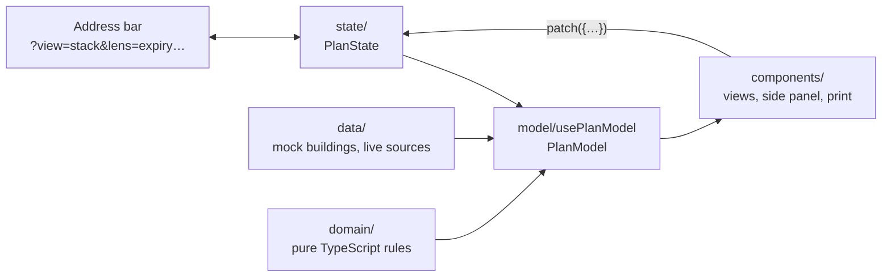

# Stax: how the code is built

Companion documents: `DESIGN.md` (what each screen does), `PLAN.md` (requirements and roadmap), `INFRASTRUCTURE.md` (hosting the app in an iframe). This page covers `src/`: its layers, how one change moves through them, and the rules that keep the domain logic portable to Salesforce.

## 1. Overview

One building record (`Property`) and one state object (`PlanState`) go in; one derived model (`PlanModel`) comes out, and every view draws from it.

- **`state/`** holds what the user is looking at: the building, view, lens, as-of date, selection, filters, prospect-safe mode and theme. All of it lives in the address, so every screen is a link.
- **`model/usePlanModel.ts`** derives everything the views draw from the property and the state, using the functions in `domain/`.
- **`components/`** render the model. A control changes the plan only by calling `patch` with the fields to change.

## 2. Layers

| Folder | Holds | Imports from |
|---|---|---|
| `domain/` | Pure TypeScript: the record types (`types.ts`, mirroring the AscendixRE objects field by field), segment derivation, lenses, KPIs, rollover, the space finder, search parsing, data issues, the timeline, geometry, the CSV, area comparisons, and the prospect-safe policy (`safe.ts`). No React, no browser. | `domain/` only |
| `state/` | `PlanState`, its URL parsing and writing, and the prospect-safe session (`planState.ts`, `usePlanState.ts`). Two small stores outside the URL: `hoverStore.ts` (a highlight while pointing) and `focusStore.ts` (where focus returns when a panel closes). | `domain/`, `lib/` |
| `model/` | `usePlanModel`: one `PlanModel` per render. | `domain/`, `state/` |
| `data/` | `mock/`: the buildings that open (`buildings/`), the switcher's sample entries (`portfolio.ts`) and `TODAY`. `sources/`: the footprint and area figures, cached or live. | `domain/` |
| `lib/` | The host adapter (`host.ts`), text measurement for SVG labels (`textFit.ts`), PNG and file export, `signal.ts`, media and width hooks. | `lib/` only |
| `components/` | The shell (`shell/`, `kpis/`), the five views (`building/` with the model in `hero/`, `stack/`, `floor/`, `timeline/`, `map/`), the side panel (`inspector/`, `area/`), the printed report (`print/`), shared plan helpers (`plan/`) and UI primitives (`ui/`). Each folder has its own stylesheet. | Everything above |
| `styles/` | Tokens, base styles, the glass skin, the two palettes and print. | — |

`App.tsx` is the shell; `main.tsx` mounts it and loads the global stylesheets. View-specific derivations live in plain `.ts` helpers beside their components (`plan/segmentText.ts`, `building/floorFact.ts`, `floor/floorData.ts`) and are tested like the domain.

## 3. One change, start to finish

1. A control calls `patch({…})` with the fields to change. Navigation that several views share (select a suite, open a floor, open its floor plate, clear the selection) is in `components/plan/actions.ts`.
2. `usePlanState` hands the patch to `stepSession` (`state/planState.ts`), which applies it and then enforces the prospect-safe rules (§5). No handler has to clear anything itself.
3. The new state is written to the address with `history.replaceState` (through the host, §6), defaults left out. Back and Forward open an address afresh.
4. `App.tsx` picks the building (`buildingById(state.building)`), works out the side panel's mode (`deriveMode`) and calls `usePlanModel(property, state, TODAY)`.
5. `usePlanModel` derives, in order: the floors and their segments (`deriveFloors`), the copy prospect-safe mode may see (`publishedFloors`, then `safeFloors`), the KPIs and their change since today, the rollover, data issues, the legend, the timeline, finder results, worklists, search hits, and the highlight with the line that names it.
6. The views render from `model` and `state`.

## 4. Segments

`deriveFloors` (`domain/derive.ts`) turns a property and an as-of date into floors, and each floor into **segments**: the stretches of floor area that every view draws. A segment has one kind: `leased`, `holdover`, `mtm`, `available`, `sublease`, `committed` (signed, not yet in), `projected` (a vacancy at a future date), `unmarketed` (no lease or listing) or `forsale`. Its key names the record it comes from (`L13-U1` for a lease's unit, `A02` for an availability, `F2-gap` for unaccounted area) and is what `?select=` holds.

A stack block, a building slice, a timeline bar, a floor-plate slice, a map floor, a phone row, a printed block and a CSV row are all segments. `components/plan/segmentText.ts` gives every view the same name, lines, badges, tooltip and accessible name for a segment, so the views cannot disagree.

A figure shown in more than one place comes from one function. `largestBlock` (`domain/kpis.ts`) gives the KPI its number and the plan the suites it lights; legend shares are rounded once each, as the KPI bar rounds them. The screen, the PDF and the CSV therefore show the same numbers.

## 5. Prospect-safe mode

`domain/safe.ts` is the only place that decides what a prospect may see; its header comment lists every rule. Components ask its named questions (`canShowDeals`, `rentVisible`, `tenantLabel`, …) or render its projections. They do not test the `safe` flag with rules of their own. The policy is enforced at three levels:

| Level | How | Where |
|---|---|---|
| State | Turning the mode on drops what it never holds: another as-of date, the Expiration and Pipeline lenses, the worklist and rollover highlight, the issues panel, a search and a matched inquiry. What it dropped is kept beside the state, never in it or in the address, and comes back when the mode is turned off. | `state/planState.ts`: `safeState`, `enterSafe`, `stepSession` |
| Model | The plan is drawn as of today. Views draw a copy of the floors with no lease dates and no quiet listings, and withheld figures are zeroed. | `planDate`, `publishedFloors`, `safeFloors`, `safeKpis`, `safeRollover` |
| Views | Labels and lists pass through the policy. | `tenantLabel`, `visibleDeals`, `rentVisible`, … |

`npm run leakcheck` checks the result in a browser: page text, accessible names, titles, tooltips, the print layout, the CSV and the address, for links opened with the mode on, for later as-of dates, and at the moment the switch is turned on.

## 6. The page: `lib/host.ts`

Everything the app asks of the browser page goes through `lib/host.ts`: the address and the tab title, root attributes and style variables, finding elements and the focused one, the window's size and events, printing, the clipboard, downloads, fonts, animation frames and observers. `lib/host.boundary.test.ts` fails, naming file and line, if any file other than `main.tsx` uses `window`, `document`, `matchMedia`, `requestAnimationFrame`, `ResizeObserver` or their kin. A Salesforce host (a Lightning web component, or the iframe in `INFRASTRUCTURE.md`) supplies its own `Host` through `setHost`, and no other file changes.

Parts of the tree that are far apart talk through a `Signal` that both import (`lib/signal.ts`), never through events dispatched on the page. The header's "Record video" reaches the map this way.

## 7. The shell

`App.tsx` renders, top to bottom:

- the header, the KPI bar and the toolbar, in every view and state, so the plan never moves when the view or the selection changes;
- the **stage**: one of the five views (`building`, `stack`, `floor`, `timeline`, `map`). On a phone the Stack view stands in for the Building view (`shownView`);
- the **side panel** (the inspector): beside the stage at 1100 px and wider, a bottom sheet (`components/ui/Sheet.tsx`) below that. Its mode (`building`, `block`, `floor`, `find`, `worklist`, `issues`, `area`, `brief`) comes from `deriveMode`;
- the **print layout** (`components/print/PrintLayout.tsx`): always mounted and hidden on screen. The browser prints it, and `?print=1` shows it.

Easy to trip over:

- **The stage is rebuilt when the web font loads** (except the Map view) and when the building changes. Labels are fitted by measuring text (`lib/textFit.ts`), so the stage is keyed on a font epoch; it moves focus back to the same control after the rebuild. A view's local React state resets at that moment, so anything that must survive belongs in `PlanState` or a store.
- **The map and the Area panel load on demand** (`React.lazy`), which keeps MapLibre out of the first screen's bundle.
- **Transient highlights stay out of the address.** Pointing at a KPI or a finder option lights suites through `state/hoverStore.ts`.
- **Focus returns to what opened a panel** (`rememberTrigger` and `refocusTrigger` in `state/focusStore.ts`).

## 8. Data

- `data/mock/buildings/index.ts` lists the buildings that open (`BUILDINGS`); the first, Preston Park Financial Center (`P001`), is the default. The other buildings build their records with `kit()` (`kit.ts`), and `buildings.test.ts` checks that no two buildings share a record id. `data/mock/portfolio.ts` holds the switcher's sample entries, which do not open.
- `TODAY` (`data/mock/property.ts`) is fixed at 2026-11-09 so screenshots repeat. Code takes "today" from it, never from the clock.
- Preston Park's edge cases are deliberate: holdover, month-to-month, a signed future lease, occupied space marketed for later, a sublease, an over-allocated floor, a multi-floor tenant, a confidential lease, records with no floor or no units, a for-sale unit and a stale record. Tests, screenshots and the judge brief quote its figures, so changing it changes their expectations.
- `data/sources/` reads the footprint and the area figures through `DataSource`. `MockSource` returns the cached copies. `?live=1` uses `OverpassSource` (OpenStreetMap) and `CensusSource` (with `?census=<key>`), each falling back to the cached copy on any failure, so the view always renders. Live mode never waits on the shared Overpass servers: `watchArea` answers at once with the best copy of the stops and places on hand (the last live answer this browser kept, through `host.readStore`, else the copy recorded with the app in `data/snapshots/`), dated in the panel and the brief, then again with OpenStreetMap's own answer, which it keeps for the next visit (`data/sources/placesBackup.ts`). A production `SalesforceSource` would build the same `Property` (`INFRASTRUCTURE.md` §4.1).

## 9. Styles

Plain CSS with no CSS-in-JS, so the Lightning port can reuse it. `styles/tokens.css` defines the tokens, named after SLDS 2 styling hooks. `glass.css` is the default skin; `ascendix.css` (the default palette) and `vice.css` (`?palette=vice`) override tokens only, so layout and behavior are the same in both palettes. `App.tsx` sets `data-skin`, `data-palette` and `data-theme` on the root element through the host. Each component folder's stylesheet reads the tokens. Print always stays white. `styles/ascendix.test.ts` and `styles/vice.test.ts` check every tone against card colors measured in the browser: contrast, ramp order and color-blind separation.

## 10. Tests and checks

- **Unit tests** (Vitest) sit beside the code as `*.test.ts(x)` and run in Node, without a DOM. Components render to a string with `react-dom/server`, and `components/inspector/testModel.ts` builds a `PlanModel` without the hook. Without a canvas, text is measured with an estimate of 0.55 × the font size per character, and tests choose their widths against it.
- **Browser checks** (`scripts/*.mjs`, Playwright driving Google Chrome) run against the preview build on port 4180: `verify` (smoke and keyboard), `motioncheck` (motion, the one check that runs with motion on), `a11y` (axe-core, desktop and phone), `leakcheck` (prospect-safe), `exportcheck` (PNG and CSV) and `pdfcheck` (the printed report), plus `shots` and `pdf` for each judging round. The commands are in the README's "Run it" section.

## 11. Where a change goes

| To | Change |
|---|---|
| Add a URL parameter | `PlanState`, `DEFAULT_STATE`, `parseState` and `serializeState` in `state/planState.ts`; its tests; the URL table in the README |
| Add a state of space | `SegmentKind` in `domain/derive.ts`; its tone and legend entry in `domain/lenses.ts`; `components/plan/segmentText.ts`; its tone tokens in `styles/` (tokens, skin and both palettes); `domain/safe.ts` if a prospect must not see it; `domain/issues.ts` if it is a data problem |
| Add or change a figure | The domain module that owns it (`domain/kpis.ts` for the KPI bar), then every place that shows it: the views, the print layout, the CSV |
| Show something new to a prospect, or hide it | `domain/safe.ts`, then `scripts/leakcheck.mjs` |
| Rename a label | Every place it appears, then `scripts/leakcheck.mjs`, which matches on labels |
| Add a building | A file in `data/mock/buildings/` built with `kit()`, registered in `BUILDINGS` |
| Add a state the judges should see | `STATES` in `scripts/shots.mjs` and the screenshot list in `docs/JUDGE_PROMPT.md` |
