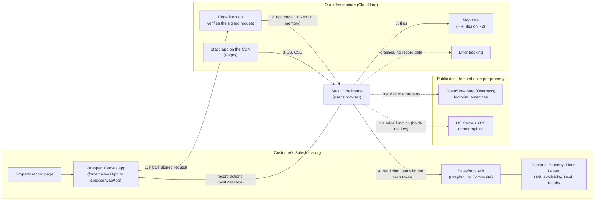

# Stax: infrastructure for the iframe deployment

Companion to `PLAN.md`. `PLAN.md` §4 describes a full port to Lightning Web Components (LWC). This document describes the alternative: run Stax as a hosted web app and show it inside the AscendixRE Property page in an iframe. It covers the architecture, sign-in, what runs where, and what it costs to run. Team, phases and build effort are out of scope and belong to the implementation plan.

## 1. Summary

- **Shape.** A static web app on a CDN, one small edge function for sign-in, and self-hosted map tiles. The user's browser reads the plan's data straight from Salesforce with the user's own access token. No customer data passes through or is stored on our servers.
- **Running cost.** About **$0–10 a month** for a pilot, **about $60 a month** at 50 customer orgs and 2,000 users, and **about $170–400 a month** at 500 orgs and 20,000 users (§5).
- **The one cost to watch is map tiles.** Self-hosted tiles cost tens of dollars at scale; a per-map-load provider such as Mapbox costs about $350 a month at the middle scenario and about $3,700 at the largest (§5.4).
- **The cost the customer carries** is Salesforce API calls: an iframe reads through the API, so every plan open counts against the org's daily API allowance. LWC with Apex does not (§6).
- **Reuse.** The current app runs almost unchanged. The new code is a Salesforce data source, the sign-in handshake and a small message bridge to the page around the iframe (§4).

## 2. Architecture



| Part | What it does | Where it runs |
|---|---|---|
| Wrapper | Places the app on the Property page and passes the record id and a signed sign-in request. Receives record actions (open record, new deal, log call) and performs them with Lightning navigation and quick actions. | Customer's org (installed with a small package) |
| Edge function | Checks the Canvas signed request with the connected app's secret, then returns the app page with the access token in memory. Also proxies the Census API so its key stays private. | Cloudflare Workers |
| Static app | The built `dist/`: about 195 KB gzipped for the first screen, plus about 290 KB for the map, which loads only when the map is opened. | Cloudflare Pages |
| Map tiles | One basemap file (PMTiles) read with range requests. Replaces OpenFreeMap, which has no service guarantee. | Cloudflare R2 behind the Worker |
| Error tracking | Script errors and performance from users' browsers. It must be set up never to send record data (tenant names, rents). | Sentry or similar |
| Public data | Building footprint, amenities and demographics. Fetched once per property and cached (§4.3). | OpenStreetMap, US Census |

There is no database, no application server and no queue.

## 3. Sign-in and embedding

### 3.1 Recommended: Salesforce Canvas

1. The admin installs a small package that contains the connected app (or External Client App) set up for Canvas with a signed request, and the wrapper component.
2. When the Property page opens, Salesforce POSTs a signed request to our edge function. The request includes the user, the org's instance URL, an OAuth access token and the record id.
3. The edge function checks the HMAC signature with the consumer secret and returns the app with the context in a script block. Nothing is stored.
4. The app keeps the token **in memory only**. It sets no cookies and uses no local storage for the token. Safari and Chrome block or partition third-party cookies and storage inside iframes, so the design must not depend on them.
5. When the token expires, the app asks the wrapper for a fresh signed request (`Sfdc.canvas.client.refreshSignedRequest`).

### 3.2 Alternative: plain iframe in an LWC with OAuth

An LWC renders an `<iframe>`, and the app signs in with OAuth 2.0 (authorization code with PKCE) in a pop-up window. This avoids Canvas, but the user sees a sign-in pop-up the first time and the pop-up flow is harder to make reliable. Use it only if Canvas is ruled out.

### 3.3 Security settings

| Side | Setting |
|---|---|
| Our host | `Content-Security-Policy: frame-ancestors` limited to Salesforce domains (`https://*.lightning.force.com https://*.my.salesforce.com https://*.force.com https://*.visualforce.com`); HSTS; no cookies |
| Our host | `connect-src` limited to `https://*.my.salesforce.com`, our tile and function origins, and the error tracker |
| Customer org | Connected app with the `api` and `refresh_token` scopes only, set to admin-approved users. For the LWC alternative, a Trusted URL for our domain with `frame-src` allowed. |
| Message bridge | Both sides check `event.origin` on every `postMessage`; only a fixed list of action names is accepted |
| Prospect-safe mode | Driven by a permission set the app reads from the user's permissions, not only by a URL flag |

## 4. Changes to this codebase

### 4.1 Data

A new `SalesforceSource` under `src/data/sources/`, next to `CensusSource.ts` and `OverpassSource.ts`. It builds the same `Property` object that `src/data/mock/property.ts` builds today, from the queries in `PLAN.md` §4.2. Use one GraphQL query, or one Composite request, so a plan open costs 1–2 API calls instead of about 8. Field-level security and sharing are enforced by Salesforce because the query runs as the user.

### 4.2 Page

`src/lib/host.ts` stays the browser host: inside an iframe the app owns its own document again. Three changes:

- **State.** The query string of the iframe is not visible to the user, so "Copy link" builds a Salesforce record URL with the state in a page parameter that the wrapper passes back.
- **Height.** The app posts its content height to the wrapper so the frame grows instead of scrolling inside the page.
- **Record actions.** The toast stubs become messages to the wrapper.

### 4.3 Public data cache

The footprint, amenities and demographics are public data and change rarely. On a property's first map view the edge function fetches them once from Overpass and Census, and keeps them for 30 days in Workers KV or R2, keyed by the property's coordinates. The free allowances cover this at every scale below. Holding only public data keeps our servers free of customer records.

## 5. Cost model

### 5.1 Inputs

| Input | Symbol | Pilot | Production | Scale |
|---|---|---|---|---|
| Customer orgs | O | 5 | 50 | 500 |
| Active users | U | 100 | 2,000 | 20,000 |
| Plan opens per user per working day | P | 10 | 10 | 10 |
| Working days per month | W | 21 | 21 | 21 |
| Share of opens that show the map | M | 30 % | 30 % | 30 % |
| Tile requests per map view | T | 100 | 100 | 100 |
| Share of tile requests the CDN cache misses | H | 50 % | 50 % | 50 % |

Change these to match a forecast; the formulas in §5.3 do the rest.

### 5.2 Unit prices

Checked November 2026 from the vendors' public pricing pages. Confirm before quoting a customer.

| Service | Price |
|---|---|
| Cloudflare Workers Paid | $5 a month per account, 10 million requests included, then $0.30 per million |
| Cloudflare R2 storage | $0.015 per GB-month, first 10 GB free; no egress charge |
| Cloudflare R2 reads (Class B) | $0.36 per million, first 10 million a month free |
| Cloudflare Pages static assets | Free, no request limit |
| Cloudflare plan (firewall, DDoS) | Free plan, or Pro at about $25 a month |
| Mapbox GL JS (alternative to self-hosted tiles) | 50,000 map loads a month free, then $5.00, $4.00, $3.00 and $2.50 per 1,000 in bands up to 5 million |
| Error tracking (Sentry or similar) | Free developer tier; about $26 a month (Team) or about $80 (Business) |
| Basemap file (worldwide PMTiles) | About 120 GB |

### 5.3 Formulas

```
opens            = U × P × W
map views        = opens × M
tile requests    = map views × T
Worker requests  = opens (sign-in) + tile requests
Workers cost     = $5 + max(0, Worker requests − 10M) × $0.30 / 1M
R2 reads cost    = max(0, tile requests × H − 10M) × $0.36 / 1M
R2 storage cost  = (120 GB − 10 GB) × $0.015 ≈ $1.65
```

### 5.4 Results (monthly)

| | Pilot | Production | Scale |
|---|---|---|---|
| Opens | 21,000 | 420,000 | 4,200,000 |
| Map views | 6,300 | 126,000 | 1,260,000 |
| Tile requests | 0.63 M | 12.6 M | 126 M |
| Workers (sign-in and tiles) | $5 | $6 | $41 |
| R2 reads | $0 | $0 | $19 |
| R2 storage | $2 | $2 | $2 |
| Static hosting | $0 | $0 | $0 |
| Cloudflare plan | $0 | $25 | $25 (Business at about $250 if the customers' security reviews ask for it) |
| Error tracking | $0 | $26 | $80 |
| Domain and TLS | about $1 | about $1 | about $1 |
| **Total, self-hosted tiles** | **≈ $8** | **≈ $60** | **≈ $170** (≈ $400 with Cloudflare Business) |
| Same, with Mapbox instead of self-hosted tiles | ≈ $6 | ≈ $410 | ≈ $3,810 |
| Same, with OpenFreeMap (pilot only, no SLA) | ≈ $1 | not advised | not advised |

Mapbox is counted by map load: 126,000 loads cost about $354 and 1.26 million about $3,700, before the other lines. Self-hosting needs one extra library (the PMTiles protocol for MapLibre) and a refresh of the basemap file once or twice a year.

### 5.5 Not included

- Staging and development copies: they share the same Cloudflare account and stay inside the free allowances, so they add about $0.
- People time for operations; that belongs to the support plan.
- Salesforce licenses, which the customer already has.

## 6. Costs on the customer's side

**API allowance.** An Enterprise Edition org gets 100,000 API calls per rolling 24 hours, plus 1,000 for each Salesforce license. At 1–2 calls per open with one batched query:

```
calls per org per day = users in the org × P × calls per open
40 users × 10 opens × 2 calls = 800 a day (under 1 % of the minimum allowance)
```

Without batching, about 8 calls per open, it would be 3,200 a day: still small, but worth avoiding. The app should read the org's remaining allowance from the `/limits` resource and show a clear message instead of failing when it runs out.

**Professional Edition** does not include API access without a paid add-on, so Professional Edition customers cannot use the iframe version unless they buy it. The LWC version has no such limit.

**Setup per org:** install the package, approve the connected app for users, assign the permission sets. No setup in the customer's network.

## 7. One-time and yearly costs

| Item | Cost |
|---|---|
| AppExchange security review | The hosted endpoints are reviewed with the package, and a scan report for them is required. An OWASP ZAP scan costs nothing; an outside penetration test is roughly $5,000–15,000. Salesforce's review fee for paid apps applies; check the current amount. |
| Domain | About $15 a year |
| SOC 2 or a similar audit | Not needed while no customer data is stored or processed on our side. It becomes likely as soon as a backend holds records (§9). |

## 8. Environments and operations

| Environment | Purpose | Connected to |
|---|---|---|
| Development | Each pull request gets a preview URL from Cloudflare Pages | A Developer Edition org with the mock building loaded |
| Staging | Release candidate, checked with `npm run verify`, `a11y`, `leakcheck` and `exportcheck` against a real org | A partner sandbox |
| Production | Customers | Customer orgs |

- **Releases** go to every customer at once when production is deployed. Asset file names carry a content hash, so a cached old version never mixes with a new one, and a rollback is re-deploying the previous build.
- **Compatibility.** The app and the installed wrapper talk through a versioned message format, so the app can be released without a package upgrade. A wrapper change needs a package version.
- **Monitoring.** Error rate and load time from the error tracker; Worker and R2 usage from the Cloudflare dashboard; an alert when tile requests pass the forecast.
- **Salesforce releases.** Run the staging checks in a preview sandbox before each of Salesforce's three releases a year.

## 9. If we add a backend later

A server between the browser and Salesforce becomes worth it for a portfolio or campus view across many buildings, scheduled owner reports, or data that Salesforce does not hold. It adds an application server, a database, a cache and a token store, roughly **$150–400 a month for a pilot, $500–1,500 in production and $2,000–5,000 or more at scale**, plus the compliance work that comes with holding tenant and rent data. Keep the first release without one.

## 10. Iframe or LWC

| | Iframe (this document) | LWC (`PLAN.md` §4) |
|---|---|---|
| Monthly infrastructure | §5: about $8 to $400 | About $0, plus self-hosted map tiles |
| Customer API allowance | Used, 1–2 calls per open | Not used (Apex) |
| Professional Edition | Needs the API add-on | Works |
| Releases | Once, for every customer at once | Package versions and upgrades |
| Reuse of this codebase | Almost all of it | `src/domain` only; the screens are rebuilt |
| Record actions | Through the wrapper | Native |
| Salesforce mobile app | Works in a frame, less smoothly | Native |
| Security review scope | Package and our hosted endpoints | Package only |

## 11. Risks and open decisions

- **Canvas availability.** Canvas is supported but older. Confirm it is offered in the target orgs and in the Salesforce mobile app before committing; otherwise use §3.2.
- **Token in the browser.** The access token lives in the iframe's memory. A strict CSP, no third-party scripts besides the error tracker, and origin checks on every message are what protect it.
- **Error tracker leaks.** Error reports must be scrubbed of record data, and `npm run leakcheck` should cover the reports the app sends.
- **Tile hosting.** Self-hosting is the cheapest, but the basemap must be refreshed, and the map's attribution to OpenStreetMap kept.
- **Decisions needed:** Canvas or plain iframe; self-hosted tiles or a provider; the error tracker; whether Professional Edition customers are in scope.

## Sources

- Cloudflare Workers pricing: <https://developers.cloudflare.com/workers/platform/pricing/>
- Cloudflare R2 pricing: <https://developers.cloudflare.com/r2/pricing/>
- Mapbox GL JS pricing: <https://docs.mapbox.com/mapbox-gl-js/guides/pricing/>
- Salesforce API request limits: <https://developer.salesforce.com/docs/platform/salesforce-app-limits-cheatsheet/guide/salesforce-app-limits-platform-api.html>
